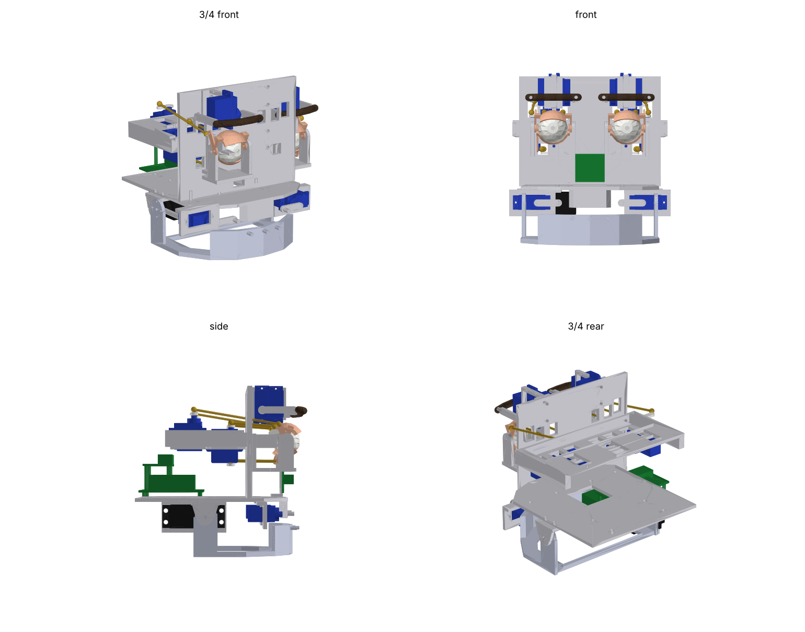
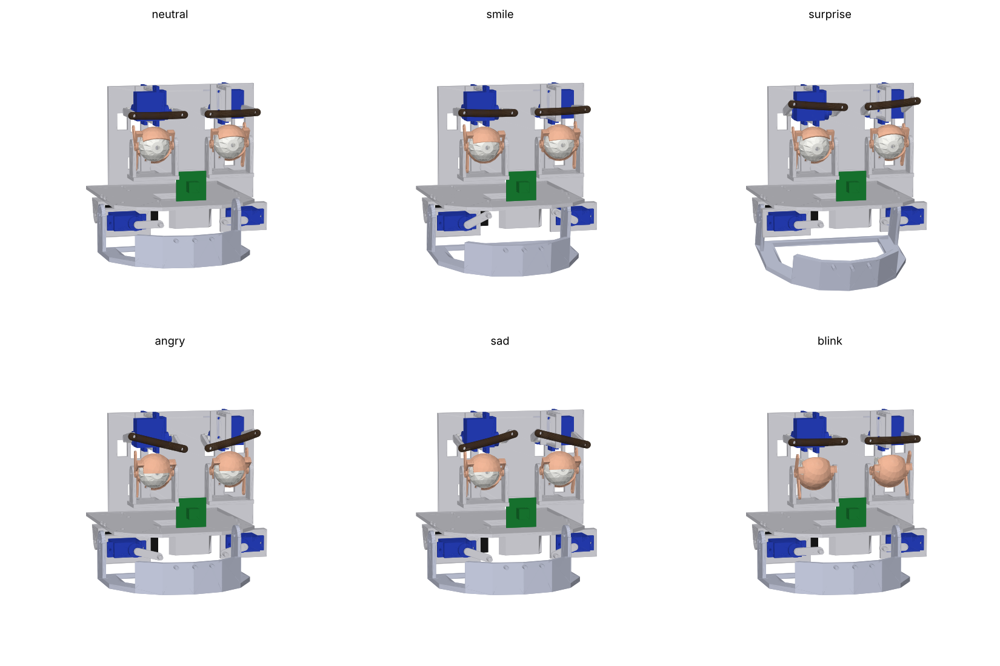

# Animatronic Face v0.1 (life-size, 3D-printable)

An expressive robot face to put an AI into. It has moving eyes, independent
eyelids, two-point eyebrows, a jaw and mouth corners. Almost everything is
3D-printed. The purchased parts are 15 hobby servos, a servo driver, a
Raspberry Pi, a camera, push-rods and screws.




* **Scale:** 1:1 human (63 mm eye spacing, 25 mm eyeballs). A 5'7" (170 cm)
  person has a head about 22-23 cm tall and about 15 cm wide. The whole
  mechanism fits in **140 x 148 x 148 mm**, so it drops straight into the
  full-size build later with no rescaling.
* **No neck or head motion yet.** The base plate has 4 x M3 holes at the rear
  for a future neck. The PCA9685 has a spare channel, and you can add a second
  board for the neck.

---

## 1. View it in Onshape

1. Download `cad/exports/animatronic_face_assembly.step` from this branch. On
   GitHub, open the file and click **Download raw file**.
2. In Onshape, click **Create → Import files…** (or drag the file onto the
   Documents page) and pick the STEP file. Leave the defaults on. Onshape
   creates a Part Studio with all 68 bodies and an **Assembly** tab, keeping
   the colours.
3. Optional: also import `animatronic_face_assembly_smile.step` to see the
   smile pose.
4. To edit, either modify the imported parts in Onshape or change the
   parameters at the top of `cad/generate_face.py` and regenerate (see §7).

Colour key: grey = printed structure, white = eyeballs, peach = eyelids,
brown = TPU eyebrows, blue = MG90S servos, black = MG996R jaw servo,
gold = push-rods with ball links, green = electronics.

---

## 2. Research summary: how to make a face expressive

Facial expressions are described with Ekman's **Facial Action Coding System
(FACS)**. Each muscle movement is an *Action Unit (AU)*, and the six basic
emotions (happy, sad, surprise, fear, anger, disgust) are combinations of a
small set of AUs. Research heads such as Two-Ts (an open-source 3D-printed
head built around FACS) and Columbia's EVA face use this approach. They
actuate a handful of points that correspond to AUs instead of copying every
muscle. EVA's replication report found that too few or poorly placed points
give unconvincing results. So this design spends its servos on the AUs that
carry the most emotional information:

| Region | AUs covered | DOF in v0.1 | Why |
|---|---|---|---|
| Eyes (gaze) | eye pan/tilt (AU 61-64) | 2 per eye (4) | Gaze is the strongest "alive" cue. Independent eyes allow vergence (focusing on something close). |
| Upper lids | AU 5 (lid raiser), AU 43/45 (close/blink) | 1 per eye (2) | Surprise, sleepy, blink, wink |
| Lower lids | AU 7 (lid tightener), AU 6 (cheek raise, partial) | 1 per eye (2) | A real (Duchenne) smile, squint, anger. Most hobby heads skip this, which is why their smiles look fake. |
| Brows | AU 1 (inner raise), AU 2 (outer raise), AU 4 (lowerer) | 2 per brow (4) | Sad = inner up, angry = inner down, surprise = both up. Brow tilt needs 2 points per side. |
| Jaw | AU 26/27 (jaw drop) | 1 | Speech sync and surprise |
| Mouth corners | AU 12 (smile), AU 15 (frown) | 1 per side (2) | The main happy/sad signal |
| **Total** | | **15 servos** | Fits one 16-channel PCA9685 |

### Mechanism choices (and where they come from)

* **Eyes: U-joint at the eye centre plus push-rods.** This is the layout used
  by Will Cogley's and Nilheim Mechatronics' open-source eye mechanisms, which
  are among the most-built hobby designs. The eyeball is a hollow 25 mm
  shell. A printed cross block inside it is held by a fixed fork, so the eye
  pivots about its true centre and the eyelids can wrap tightly around it.
  Two ball-link rods connect to two lugs on the back of each eye
  **differentially**: pushing both rods tilts the eye, and pushing them
  opposite ways pans it. The software does the mixing:
  `A = tilt + pan`, `B = tilt - pan`.
  Usable range is about ±20° pan and tilt (limit this in software).
* **Eyelids: nested spherical shells pivoting on the eye's horizontal axis**
  (same idea as Cogley's mechanism). The lower lid is the inner shell
  (R 13-14.2) and the upper lid is the outer shell (R 14.4-15.6). They hinge
  on 2 mm steel pins in the eye frame's side plates. Each lid lever is
  roughly perpendicular to its push-rod at mid-travel, which gives the best
  force and the most linear motion.
  The lower-lid servos hang upside-down under the cradle so that their rods
  run underneath the eyes.
* **Brows: direct drive.** Each brow is a flexible TPU strip on two pegs.
  Each peg sits on a lever bolted directly to a servo horn, with no linkages
  to wear. Because the strip flexes, the inner and outer servos produce brow
  *tilt* as well as raise and lower.
* **Jaw: direct drive at the TMJ (jaw hinge) position.** The MG996R output
  shaft is the right-hand hinge, and the left side is an M3 hinge pin. This
  is the same approach as InMoov's jaw. Upgrade to a 20 kg servo once skin is
  on, because silicone resists motion a lot.
* **Mouth corners: direct-drive levers** on servos mounted behind the upper
  lip. Each lever tip has a forward post that becomes the skin anchor. A
  student project (Cal Poly Pomona) and the 12-servo mouth paper on arXiv
  both show that the corners are the minimum needed for smile/frown. Upper
  and lower lip servos, pucker and sneer can come later.
* **Skin (phase 2).** Platinum silicone (Ecoflex or Dragon Skin) cast in
  printed moulds, attached to the lever posts with magnets or Velcro. InMoov
  builders and the "frighteningly realistic" Arduino-blog head both do this.
  All lever tips already end in forward-facing posts for this.

---

## 3. Parts list

Full list with specs and notes: **[BOM.csv](BOM.csv)**. Summary:

| Item | Qty |
|---|---|
| MG90S metal-gear micro servo | 14 (+ spares) |
| MG996R servo (jaw), or DS3218 20 kg later | 1 |
| PCA9685 16-ch servo driver | 1 |
| Raspberry Pi 5 8 GB + cooler + 27 W PSU + 64 GB SD | 1 |
| Raspberry Pi Camera Module 3 Wide + Pi 5 cable | 1 |
| 5 V 10 A PSU for servos + 1000 µF capacitor | 1 |
| USB mic (or ReSpeaker array), MAX98357A amp, 40 mm speaker | 1 each |
| M2 ball-link push-rod kit (8 rods, 16 links) | 1 |
| 2 mm steel rod 300 mm (pivot pins) | 1 |
| M2 self-tapping and M3 screw/nut assortments, M3 heat-set inserts | — |
| 12 mm glass cabochons (iris lenses) | 2 |
| PLA+/PETG (about 250 g used), TPU 95A (brows) | — |

**Rough cost: about $190 for the mechanism and servo electronics, or about
$350-400 including the Pi 5, camera and audio.**

### Printed parts (`cad/exports/stl/`, matching STEP in `cad/exports/step/`)

STLs are exported in assembly position. Lay them flat in the slicer. Parts
marked *mirror* are exported for the right side only; print a mirrored copy
for the left.

| File | Qty | Material | Notes |
|---|---|---|---|
| face_plate | 1 | PLA/PETG | 4 walls, 25 % infill |
| base_plate | 1 | PLA/PETG | Palate + neck mount + electronics deck |
| eye_servo_cradle | 1 | PLA/PETG | Holds the 8 eye/lid servos |
| eye_frame | 2 | PETG | Symmetric. Ream the pin holes to 2 mm |
| eyeball_front_half + eyeball_rear_half | 2 each | PLA (white) | Glue the halves around the cross. Print the front half dome-up with tree supports |
| eye_cross | 2 | PETG or resin | Tiny U-joint block. Print several |
| eyelid_upper, eyelid_lower | 2 each (*mirror*) | PETG, 0.12 mm layers | Print on tree supports, or in resin |
| brow_bracket | 2 (*mirror*) | PLA/PETG | |
| brow_lever_in, brow_lever_out | 2 each (*mirror*) | PETG | Bolt to the servo horn |
| brow_strip | 2 (*mirror*) | **TPU 95A** | |
| jaw | 1 | PLA/PETG | |
| jaw_hinge_bracket | 2 (*mirror*) | PETG | |
| jaw_servo_bracket | 1 | PETG | |
| cheek_bracket | 2 (*mirror*) | PLA/PETG | Holds the mouth-corner servos |
| mouth_corner_lever | 2 (*mirror*) | PETG | |
| camera_mount | 1 | PLA | Pi Camera 3 in the nose bridge |

---

## 4. Servo channel map and expression table

| PCA9685 ch | Servo | | PCA9685 ch | Servo |
|---|---|---|---|---|
| 0 | eye R, rod A | | 8 | brow R inner |
| 1 | eye R, rod B | | 9 | brow R outer |
| 2 | eye L, rod A | | 10 | brow L inner |
| 3 | eye L, rod B | | 11 | brow L outer |
| 4 | upper lid R | | 12 | jaw |
| 5 | lower lid R | | 13 | mouth corner R |
| 6 | upper lid L | | 14 | mouth corner L |
| 7 | lower lid L | | 15 | spare (neck later) |

Pose values, in degrees of motion of the *part*. These are the same numbers
as `POSES` in `cad/generate_face.py`. Map them to servo angles with per-servo
trim and sign during calibration.

| Pose | pan | tilt | upper lid | lower lid | brow inner | brow outer | jaw | corners |
|---|---|---|---|---|---|---|---|---|
| neutral | 0 | 0 | 0 | 0 | 0 | 0 | 0 | 0 |
| smile (Duchenne) | 0 | 0 | -10 | +15 | +5 | +5 | 6 | +25 |
| surprise | 0 | +5 | +8 | -5 | +20 | +20 | 18 | 0 |
| angry | 0 | -5 | -25 | +10 | -20 | +10 | 0 | -15 |
| sad | 0 | -10 | -20 | 0 | +20 | -10 | 0 | -20 |
| blink | 0 | 0 | -55 | +40 | 0 | 0 | 0 | 0 |

Lid sign convention: upper lid negative = closing, lower lid positive =
closing. Mouth corner positive = up (smile).

---

## 5. Assembly order (short version)

1. **Eyes.** Push the eye_cross into the fork on the eye_frame and fix it
   with two M2 x 6 screws (top and bottom pan stubs). Close the two eyeball
   halves around it. Slide a 2 mm x 25 mm pin through the side holes of the
   eye and through the cross (tilt axis). Glue the halves together. Add the
   lower lid, then the upper lid, on 2 mm pins through the frame side plates.
   Screw M2 ball studs into the eye lugs and lid levers.
2. Bolt both eye frames, the two brow brackets and the camera mount to the
   **face plate**. Bolt the face plate onto the **base plate**.
3. Fit the 8 eye/lid servos into the **eye servo cradle**. The two lower-lid
   servos hang upside-down under the front shelf. Bolt the cradle to the back
   of the face plate.
4. **Centre every servo (1500 µs) before fitting the horns.** Then fit the
   push-rods: screw the ball links onto M2 rod cut to length so that each eye
   and lid is in its neutral position at servo centre.
5. Fit the brow servos, levers and TPU strips. Fit the cheek brackets with
   the corner servos and levers. Fit the jaw servo bracket, the MG996R, the
   hinge brackets and the jaw (M3 x 30 hinge pin on the left).
6. Electronics: mount the Pi 5 on the base plate deck with the PCA9685 on
   standoffs above it. Connect the servo PSU to the PCA9685 V+ terminal with
   the capacitor across it. Connect I2C to the Pi.

---

## 6. Known limitations (v0.1). Read before printing everything

* This is a **first-pass concept CAD**. Collisions were checked with a solid
  intersection test in 7 poses (`python generate_face.py --check`), all
  clean, but some clearances are tight (0.3-0.6 mm). The servo horns are not
  rotated in the pose models; only the driven parts move. **Print one eye
  module (frame, eyeball, cross, lids) first** and test it by hand before
  printing the rest.
* Servo envelopes come from datasheet dimensions. MG90S/MG996R clones vary by
  about 0.5 mm, so check yours with calipers. Pockets have 0.3 mm clearance.
  Edit `SERVOS` in the script if needed.
* The eye range is limited to about ±20° by the U-joint post. That is
  realistic for conversation, but not for extreme side glances.
* There is no skull shell or skin yet. Those are phase 2.
* Pi 5 and PCA9685 positions are placeholders on the base plate deck. No
  mounting bosses are modelled yet; use standoffs.

## 7. Regenerating / editing the CAD

```bash
pip install cadquery matplotlib
```

```bash
cd animatronic-face/cad
```

```bash
python generate_face.py --check          # neutral pose + all part files + collision check
```

```bash
python generate_face.py --pose smile --no-parts
```

```bash
python render_previews.py
```

All key dimensions are named constants at the top of `generate_face.py`: eye
spacing, eye size, lid radii, servo models, hinge position, and so on.

## 8. Next steps

1. Print and test one eye module, then the full face.
2. Write the controller: Python on the Pi with `adafruit-circuitpython-servokit`,
   an expression blender (interpolating between the poses above), blinking
   every 3-6 s at random, saccades (small random gaze jumps), jaw driven by
   speech audio amplitude, and gaze following faces from the camera.
3. Connect the AI: speech-to-text, then an LLM (e.g. the Claude API) that
   returns text plus an emotion tag, then text-to-speech with the jaw synced
   to the audio, and the emotion tag driving the expression.
4. Phase 2: silicone skin moulds, skull shell, neck (pan/tilt/roll), then the
   5'7" body.

### Sources

* [Simplified 3D Printed Animatronic Dual Eye Mechanism (Will Cogley, Instructables)](https://www.instructables.com/Simplified-3D-Printed-Animatronic-Dual-Eye-Mechani)
* [Animatronic Eye Mechanism (Instructables)](https://www.instructables.com/Animatronic-Eye-Mechanism)
* [DIY Compact 3D Printed Animatronic Eye Mechanism (Instructables)](https://www.instructables.com/DIY-Compact-3D-Printed-Animatronic-Eye-Mechanism)
* [Simple animatronic eyes (Make:)](https://makezine.com/projects/simple-animatronic-eyes/)
* [How to Build a 3D Printed Animatronic Eye with Arduino (CircuitDigest)](https://circuitdigest.com/microcontroller-projects/diy-3d-printed-animatronic-eye-with-arduino)
* [Two-Ts: low-cost open-source 3D-printed FACS robot head (FAPESP record)](https://bv.fapesp.br/pt/publicacao/239280)
* [EVA facially expressive robot face, replication report (ShanghaiTech)](https://robotics.shanghaitech.edu.cn/sites/default/data/2025-04/moma2023project-eva-face.pdf)
* [OpenFACS (Cuculo & D'Amelio)](https://iris.unimore.it/handle/11380/1300658)
* [Fritz, an open-source robotic puppet (RobotShop)](https://community.robotshop.com/forum/t/fritz-a-robotic-puppet/5082)
* [Animatronic face with 12-servo mouth (arXiv 2510.23059)](https://arxiv.org/pdf/2510.23059v1)
* [Semi-flexible jaw plates for smile/frown (Cal Poly Pomona poster)](https://www.cpp.edu/honorscollege/documents/research-posters/EGR/ece_zarco.pdf)
* [Skin Deep: InMoov facial expressions and silicone skin (Make:)](https://makezine.com/article/technology/robotics/skin-deep-evolving-inmoovs-facial-expressions-with-ai)
* [Realistic animatronic head with silicone skin (Arduino Blog)](https://blog.arduino.cc/2024/12/09/this-frighteningly-realistic-animatronic-head-features-expressive-silicone-skin/)
* [InMoov neck and jaw assembly](https://inmoov.fr/build-yours/neck-and-jaw/)
* [Patent US10913161B2: robot skin with integral elastomeric links](https://patents.google.com/patent/US10913161)
